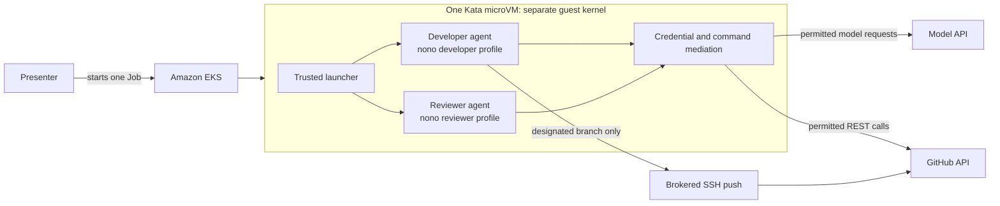

# Presenter guide

Background for building the talk: the facts, accurate statements and possible questions,
plus some optional ideas for the story and slides. What to present, and how, is the
presenter's choice. `LIVE_DEMO.md` covers running the demo; `RUNBOOK.md` covers
preparation.

## The story in one sentence

Two AI agents share a GitHub identity and one Kata-isolated workload, while
nono restricts each agent to the capabilities required by its role.

## What the audience should remember

- A credential's permissions do not have to equal an agent's permissions.
- Useful work and denied actions can coexist: least privilege does not mean
  blocking everything.
- Amazon EKS operates the Kubernetes workload.
- Kata gives the pod a separate guest kernel and isolates it from the node.
- nono applies the developer and reviewer filesystem, command, network,
  credential, and GitHub API policies inside the guest.
- The trusted launcher verifies the external result instead of trusting the
  agents to report that the policy worked.
- A human using a separate identity still approves and merges the PR.

## Capability matrix

| Capability | Developer | Reviewer |
|---|---:|---:|
| Read issue, PR, diff, and repository | Allow | Allow |
| Modify the worktree | Allow | Deny |
| Run tests | Allow | Allow |
| Push `demo/webinar-fix` | Allow | Deny |
| Open a draft PR | Allow | Deny |
| Post a PR comment | Not needed | Allow |
| Approve or merge | Deny | Deny |
| Read raw GitHub/model credentials | Deny | Deny |
| Use unrestricted network access | Deny | Deny |

## Architecture diagram draft

A possible source for a slide. These are the main components; implementation
details could go in an appendix.



Possible caption: **One workload boundary; two role-specific capability
boundaries; one independently verified GitHub result.**

## Possible slide sequence

### Slide 1 — The problem

Title: **An agent should not inherit every power of its credential**

- Agents need credentials to perform real work.
- Those credentials are usually broader than one task or role.
- Prompt instructions alone are not an authorization boundary.

Visual: one broad GitHub token pointing toward two agents with different jobs.

### Slide 2 — The design

Title: **Layered isolation on Amazon EKS**

The diagram above could be revealed layer by layer: EKS, Kata, trusted launcher,
nono profiles, credential-mediated external services.

### Slide 3 — Expected capabilities

Title: **Same identity, different powers**

The capability matrix with green allow and red deny cells; it could stay visible
before the live demo so the audience knows what is being tested.

### Slide 4 — Live demo

Title: **Useful work, then deliberate boundary tests**

Four possible checkpoints:

1. Developer fixes and pushes.
2. Developer cannot merge.
3. Reviewer comments but cannot modify.
4. PR remains open for a human.

### Slide 5 — What was proven

Title: **Observed and independently checked**

- Allowed work completed in a real Kata pod.
- Forbidden commands and endpoints were denied and audited.
- Raw Secret files remained inaccessible to both profiles.
- The launcher confirmed the PR was open, unmerged, and commented on.

### Slide 6 — Production perspective

Title: **A strong demo boundary, not a universal production topology**

- Separate pods, guests, and identities add stronger defense in depth.
- API authorization is method/path based; GraphQL is deliberately disabled.
- The launcher, image, kernel, and software supply chain remain trusted.
- Policy and adversarial tests must run again after dependency upgrades.

## Possible talk track

1. The shared-credential problem and the roles wanted.
2. EKS, Kata, nono and the trusted launcher.
3. The capability matrix and the expected denials.
4. The live run, narrating the meaningful transitions.
5. The resulting PR: the fix, the comment, and the unmerged state.
6. What was proven, what was not, and the human step.
7. Questions.

## What the audience sees in the terminal

```text
SECURE GITHUB AGENTS ON AMAZON EKS
  repository   MateSaary/webinar-demo-sandbox, issue #1
  model        <provider>/<model>, key brokered by nono
  isolation    guest kernel 6.18.12-landlock, nono 0.79.0, one role-specific profile per agent

[DEVELOPER]  nono profile: developer
00:05  ALLOW  Read issue #1
00:09  ALLOW  Modify code                         demo_app/shipping.py
00:10  ALLOW  Run tests                           tests passed
00:14  ALLOW  Open draft pull request             PR #5
00:15  DENY   Merge pull request                  command policy
                the developer may open a pull request but not merge it

[REVIEWER]  nono profile: reviewer
00:31  ALLOW  Post verdict comment                APPROVE
00:34  DENY   Create or switch branch             command policy
00:35  DENY   Submit approval                     endpoint policy
00:36  DENY   Merge pull request                  command policy

[VERIFICATION]  checked by the launcher, not reported by the agents
01:02  PASS   PR #5 is open and unmerged          draft
01:02  PASS   Reviewer added 1 comment(s)
01:08  PASS   Credential files unreadable         token, deploy key and model key, both profiles
```

Every line comes from an observed event: a tool call in the agent's stream, or
the launcher's own GitHub and credential checks. A line never appears because it
was expected. The full transcript and nono audit are in `artifacts/demo-*.log`.

## Accurate and inaccurate statements

Accurate statements:

- “Kata isolates the workload from the EKS worker node with a separate guest
  kernel.”
- “nono gives the two agents different capabilities inside that workload.”
- “The profiles were exercised adversarially in the real Kata environment.”
- “The API-key presentation path brokers the model and GitHub credentials.”
- “This is a tested least-capability design under a trusted launcher.”

Inaccurate statements:

- “Kata isolates the developer from the reviewer.”
- “The agents are formally verified or impossible to escape.”
- “The shared token itself has different permissions for each agent.”
- “This one-pod arrangement is the strongest production topology.”

## Possible questions

**Why put both agents in one Kata pod?**

To make the policy point deliberately hard: even with a shared runtime and
GitHub identity, the agents receive different effective capabilities. A
production design may use separate pods, guests, and identities for additional
defense in depth.

**Why is the reviewer comment-only?**

Both agents use the same GitHub identity, and GitHub does not allow that
identity to approve its own PR. Human approval also preserves the intended
control point.

**Why use `gh api` instead of normal `gh pr` commands?**

The pinned `gh` commands use GraphQL. The current policy can match HTTP methods
and paths but not GraphQL operations, so GraphQL is denied and explicit REST
endpoints are used.

**Is Kata doing the role authorization?**

No. Kata is the workload-to-node isolation layer. nono is the role-specific
authorization and mediation layer inside the Kata guest.

**Is this production ready?**

It is a rigorously tested webinar design. Production adoption requires a threat
model and may warrant separate identities, pods or guests, independent egress
controls, image signing, vulnerability management, and operational ownership.

## Expected resources checklist

Presenter should have:

- [ ] repository access and this document;
- [ ] the live-demo date and audience level;
- [ ] the frozen image digest (`config/image`);
- [ ] access to the AWS account, cluster, disposable GitHub repository and model
      account, without credentials passed through chat or documentation;
- [ ] one successful sanitized log and one backup recording;
- [ ] the architecture and capability slides;
- [ ] a supervised rehearsal, then independent clean rehearsals;
- [ ] a named owner for platform failures during the live session.
