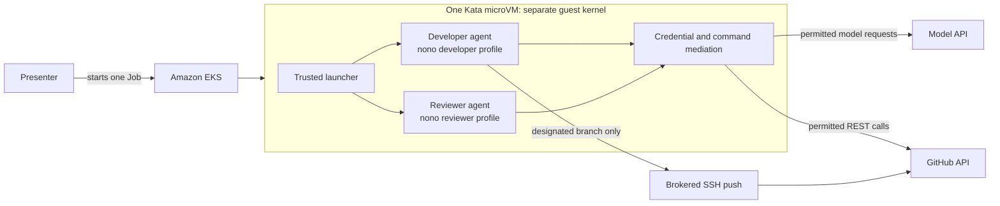

## Capability matrix

| Capability | Developer | Reviewer |
|---|---:|---:|
| Read issue, PR, diff, and repository | Allow | Allow |
| Modify the worktree | Allow | Deny |
| Run tests | Allow | Allow |
| Push `demo/webinar-fix` | Allow | Deny |
| Open a draft PR | Allow | Deny |
| Post a PR comment | Not needed | Allow |
| Approve or merge | Deny | Deny |
| Read raw GitHub/model credentials | Deny | Deny |
| Use unrestricted network access | Deny | Deny |

## Architecture diagram draft

A possible source for a slide. These are the main components; implementation
details could go in an appendix.

